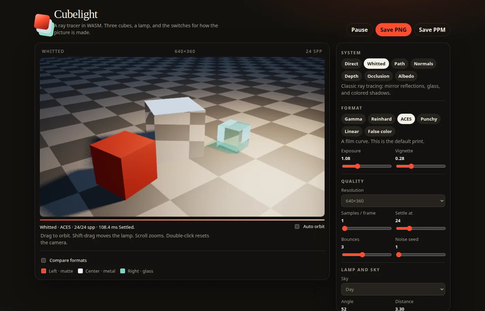

OrbitScope puts the live satellite catalog on a globe. The dots are Starlink, GPS, and the ISS. The orange marker is New York, and pass times are calculated from there.

It is not deployed yet. The code and screenshots are on [GitHub](https://github.com/michaelnjoku347/OrbitScope).

## What you can do with it

- Filter the sky to Starlink, GPS, the ISS, or all of them.
- Search by name or NORAD id.
- Click a satellite for its latitude, longitude, altitude, and the next few passes over New York. A pass counts when the satellite climbs above 10°.

The screenshot on this page is Starlink only, a bit over 10,000 satellites. GPS and the ISS are in the same catalog. The count changes when CelesTrak updates the file.

## How it works

The API is Java 21 and Spring Boot. It downloads two-line element sets from CelesTrak (Starlink, GPS, and the ISS) and refreshes them every three hours. [Orekit](https://www.orekit.org/) propagates those orbits. Positions for the whole catalog go out as parallel arrays, because one object per satellite was about 1.8 MB.

The globe is [Cesium](https://cesium.com/) and TypeScript. Drawing ten thousand `Entity` objects was too slow, so the dots are a `PointPrimitiveCollection`. The map is Cesium’s built-in Natural Earth imagery, so the page does not need a Cesium ion token.

I checked the ISS against [wheretheiss.at](https://wheretheiss.at) at the same timestamp. The difference was about 0.2 km. On this machine, Orekit took 165 ms for a long benchmark on 4 cores. A simpler array version took 4 ms, but it skips drag, so the globe stays on Orekit.

## Cubelight

The same repo now includes **Cubelight**, a Rust ray tracer compiled to WebAssembly. The default scene is three cubes on a checker floor under one lamp: matte, mirror, and glass. Shadows are real rays, and the glass tints the shadow it casts.



- Drag to orbit. Shift-drag moves the lamp. Scroll zooms. Double-click resets the camera.
- **Systems:** direct light, Whitted (reflections and refraction), path tracing, plus normals, depth, occlusion, and albedo.
- **Formats:** gamma, Reinhard, ACES, punchy, linear, and false color. A format change regrades samples already traced, so it updates immediately.
- Samples stack while the view sits still. Move anything and it starts over.

```bash
cd tracer
./serve.sh    # http://127.0.0.1:8731
```

The module ships prebuilt as `tracer/web/cubelight.wasm`. After editing `tracer/src/lib.rs`, rebuild with `./build.sh` and refresh.

## Run the globe

You need Java 21 and Node. From the repo:

```bash
./run.sh api    # http://localhost:8080
./run.sh web    # http://localhost:5173
```

The first API start downloads Orekit’s data files. CelesTrak returns an empty file if the request has no User-Agent, so the fetcher sends one.
